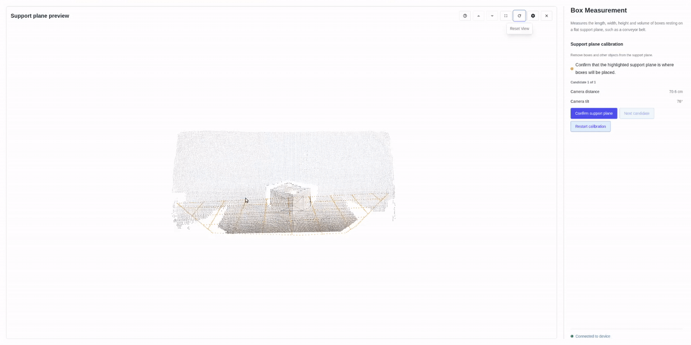
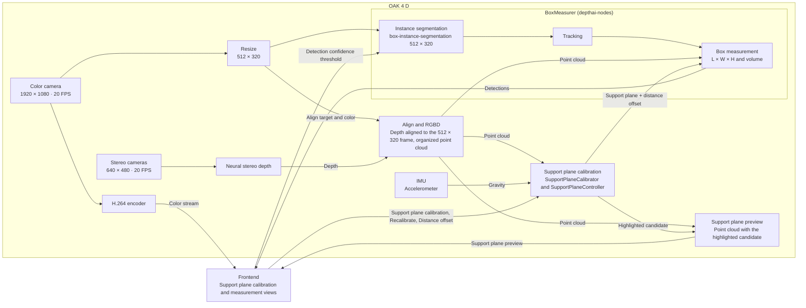

# Box Measurement

This app measures box dimensions (L × W × H) and volume live on an RVC4 device. The boxes have to rest on a flat support plane, for example a conveyor belt. Every box that passes the camera is detected, tracked and measured, and its dimensions are drawn over the color stream. Nothing is saved to the device.

The backend runs the box-measurement nodes from [depthai-nodes](https://github.com/luxonis/depthai-nodes) on neural stereo depth. The frontend, built on `@luxonis/depthai-viewer-common`, guides you through support plane calibration and then shows the measurements.

> **Note:** This example works on RVC4 in peripheral or standalone mode, and requires an **OAK 4 D** (Pro or non-Pro): box dimensions are computed from a stereo camera pair, so single-camera devices such as the **OAK 4 S** are not supported. The IR dot projector on Pro models is enabled automatically when present.

## Demo



## Architecture



Segmentation, tracking and box measurement all run inside the `BoxMeasurer` node from depthai-nodes. It measures each box against the support plane that the operator confirmed during support plane calibration, shifted by the distance offset. The support plane preview is published only while the support plane calibration view is open.

## Features

- **Live box measurement:** instance segmentation, per-box tracking and L × W × H / volume measured against the support plane
- **Support plane calibration:** support plane candidates checked against gravity from the IMU, a live preview of the highlighted candidate, and operator confirmation
- **Distance offset:** a ±10 cm correction for box heights that come out consistently too high or too low
- **Detection settings:** the detection confidence threshold, applied live

## Usage

Running this example requires a **Luxonis device** connected to your computer. Refer to the [documentation](https://docs.luxonis.com/software-v3/) to setup your device if you haven't done it already.

### Support plane calibration

The app doesn't remember the support plane, so it opens on support plane calibration after every start. Nothing is measured until a support plane is confirmed.

1. Remove boxes and other objects from the support plane, and keep it in view.
2. Wait for a support plane candidate to be highlighted in orange in the **Support plane preview**. The **Support plane calibration** section shows its camera distance and tilt.
3. If the highlighted plane isn't the one boxes will rest on, press **Next candidate**. Press **Restart calibration** to discard the candidates and search again.
4. Press **Confirm support plane**. The app switches to measuring boxes.

Repeat support plane calibration whenever the camera is moved or the belt height changes: press **Recalibrate** in the **Support plane** section.

### Measuring boxes

1. Place boxes on the support plane. Each detected box is outlined in the color stream with its L × W × H (cm) and volume (cm³).
2. If boxes are missed or false detections appear, change the detection confidence threshold (0 to 1) in **Detection settings**. It applies right away and resets when the app restarts.

#### Distance offset

If measured heights are consistently too high or too low, add a distance offset to the camera's distance from the support plane:

1. Measure the real distance from the camera to the support plane.
2. In the **Distance offset** section, enter *measured distance − detected distance* (−10 to +10 cm) with the field or the **−** and **+** buttons, and press **Apply**. The section shows the **Distance with offset**.
3. Press **Clear offset** to remove the offset right away.

Positive values move the support plane farther from the camera, so boxes measure taller. The offset mainly affects the height. It is cleared when you run support plane calibration again or restart the app.

## Peripheral Mode (RVC4)

Requires Python 3.11 and Node.js 22+.

The host also needs Open3D system libraries (`libegl1` and `libgfortran5` on Debian/Ubuntu). The device must have RGB, stereo and IMU sensors.

From this example directory:

```bash
python3.11 -m venv .venv
source .venv/bin/activate
python -m pip install -r backend/requirements.txt
cd frontend
npm ci
npm run build
cd ..
python backend/src/main.py --device <DEVICE_IP>
```

Open http://localhost:8082 on the host computer. Python runs the backend
and serves `frontend/dist` automatically; streams and controls use port 8765.
Rebuild with `npm run build` in `frontend/` after frontend changes.

## Standalone Mode (RVC4 only)

oakapp serves the frontend automatically in standalone mode.

Running the example in the standalone mode, app runs entirely on the device.
To run the example in this mode, first install the `oakctl` tool using the installation instructions [here](https://docs.luxonis.com/software-v3/oak-apps/oakctl).

The app can then be run with:

```bash
oakctl connect <DEVICE_IP>
oakctl app run .
```

The first run builds the container on the device and takes a while. The device needs internet access, since the app downloads its segmentation model on first start.

Once the app is built and running you can access the DepthAI Viewer locally by opening `https://<OAK4_IP>:9000/` in your browser (the exact URL will be shown in the terminal output).

### Remote access

1. You can upload oakapp to Luxonis Hub via oakctl
2. And then you can just remotely open App UI via App detail page
