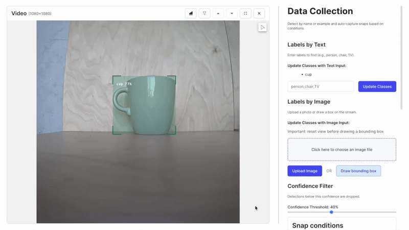

# Data Collection

This application combines on-device open-vocabulary detection with an interactive frontend to **auto-collect “snaps” (images + metadata) under configurable conditions**.\
It runs **YOLOE** on the DepthAI backend, and exposes controls in the UI for:

- Selecting labels (by **text** or **image prompt**)
- Adjusting **confidence threshold**
- Enabling **snap conditions** (timed, no detections, low confidence, lost-in-middle)

> **Note:** RVC4 peripheral or standalone mode. Requires Luxonis OS 1.40 or newer.



## Architecture

### High-level


### In-depth


## Features

- **Class control**
  - Update classes by text or upload an image to create a visual prompt
- **Confidence filter**
  - Drop detections below a chosen threshold
- **Snapping (auto-capture)**
  - **Timed** (periodic)
  - **No detections** (when a frame has zero detections)
  - **Low confidence** (if any detection falls below threshold)
  - **Lost-in-middle** (object disappears inside central area; edge buffer configurable)
  - Cooldowns **reset** when snapping is (re)started

______________________________________________________________________

## Usage

Running this example requires a **Luxonis RVC4 device** connected to your computer. Refer to the [documentation](https://docs.luxonis.com/software-v3/) to set up your device if you haven't already.

______________________________________________________________________

## Peripheral Mode (RVC4)

> Requirements pin depthai-nodes commit [`5df28b8`](https://github.com/luxonis/depthai-nodes/commit/5df28b8a65943eaf9fad74691e6cfc544728b189) for `serve_frontend`. Replace this pin with a release containing the helper before merging.

Use Python 3.12 and Node.js 22 or newer. From this example directory:

```bash
python3.12 -m venv .venv
source .venv/bin/activate
python -m pip install -r backend/requirements.txt
cd frontend
npm ci
npm run build
cd ..
python backend/src/main.py --device <DEVICE_IP>
```

Open `http://localhost:8082` on the host computer. Python serves the built custom
frontend and runs the backend; streams and controls use `RemoteConnection` on
port 8765. The frontend directory is resolved relative to the entrypoint.
Rebuild the frontend after changing its source.

Use `--frontend-dir` for another build directory, `--frontend-port` for another
HTTP port, or `--no-frontend` with a separate development server. The default
bind address is `127.0.0.1`; `--frontend-host` overrides it. Access from another
computer requires a separate HTTPS/WebSocket proxy.

Standalone mode keeps the existing oakapp frontend server. The Python helper
automatically skips its listener when that server is configured.

## Standalone Mode (RVC4)

To run the example in this mode, first install the `oakctl` tool using the installation instructions [here](https://docs.luxonis.com/software-v3/oak-apps/oakctl).

The app can then be run with:

```bash
oakctl connect <DEVICE_IP>
oakctl app run .
```

Once the app is built and running you can access the DepthAI Viewer locally by opening `https://<OAK4_IP>:9000/` in your browser (the exact URL will be shown in the terminal output).

### Remote access

1. You can upload oakapp to Luxonis Hub via oakctl
2. And then you can just remotely open App UI via App detail
