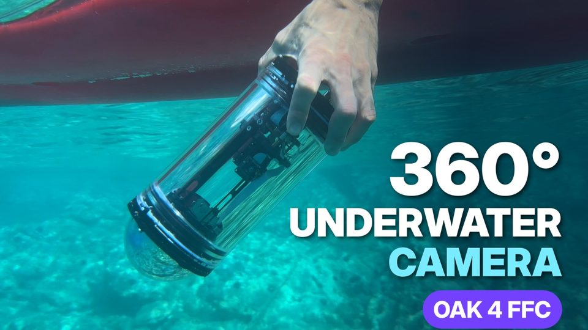

# FFC Multi-Camera Recorder

This OAK App records every camera connected to an OAK4-FFC to H.264 video as soon as the device boots, without network access or a viewer. It handles all five sockets of an OAK4-FFC, including the two that RVC4 can only serve as raw streams, and works with any camera set that `Device.getConnectedCameraFeatures()` reports.

Each camera socket is written to its own Matroska (`.mkv`) file. Matroska stores camera timestamps, so VLC plays the files at the recorded speed. All files in one session share a UTC start timestamp, for example `20260924T122306.849710Z_cama.mkv` through `20260924T122306.849710Z_came.mkv`. Files are opened exclusively, so a later boot cannot overwrite an earlier session.

> **Note:** Built and tested for RVC4 (OAK4-FFC) in standalone mode. Peripheral mode on RVC4 is useful for short test recordings.

## Example Project: Underwater 360° Camera

This recorder was used to film the [Underwater 360° Camera with OAK 4 FFC](https://docs.luxonis.com/overview/industry-examples/smart-cities-and-transportation/underwater_360_camera) project: an OAK 4 FFC and five OV9282 wide-FOV global-shutter cameras in a watertight enclosure, powered over a single PoE cable. The app started recording on boot, so the sealed camera needed no network connection underwater.

[](https://www.youtube.com/watch?v=tCZqND1Ejtg)

- [Video](https://www.youtube.com/watch?v=tCZqND1Ejtg)
- [Blog post: Building an Underwater 360° Camera with OAK 4 FFC](https://discuss.luxonis.com/blog/7071-building-an-underwater-360-camera-with-oak-4-ffc), with the full build, bill of materials, and 3D-print files
- [Documentation page](https://docs.luxonis.com/overview/industry-examples/smart-cities-and-transportation/underwater_360_camera)

## Features

- Records all detected cameras, including more cameras than RVC4 has ISP streams for
- Hardware H.264 encoding for every camera; packets are muxed without re-encoding
- Software tone mapping and startup exposure calibration for raw-only cameras
- Persistent storage with a recording quota and a free-space reserve; never deletes recordings automatically
- Offline-boot handling when the device clock resets
- Host tool to list, download, and delete complete sessions

## How Five Cameras Fit On RVC4

RVC4 supports three concurrent ISP streams plus additional raw streams. CAM_A–C feed the H.264 encoders directly through the ISP. CAM_D–E use the raw outputs: the app converts their packed RAW10 frames to grayscale NV12 on the device CPU and sends them to the hardware H.264 encoders. The app defaults to 20 FPS.

The raw conversion keeps all ten sensor bits, subtracts the OV9282 black level (64), applies gamma 2.2, and maps pixels to video luma range 16–235. Small previews from CAM_A–C supply a smoothed median brightness target. Each raw camera calibrates its exposure for the first ten seconds, then locks exposure and digital gain until the recorder restarts. Keep the cameras under the intended lighting during startup.

During calibration, the controller increases exposure first, up to 33 ms or one frame period, then uses at most 8× digital gain. A highlight guard limits exposure increases when a substantial area is already saturated. On the tested RVC4, raw-only exposure changes work, but ISO stays at 100 despite higher requests. Software processing does not reproduce every ISP operation, so raw views can differ from ISP views in contrast and sharpness.

| Option                             | Default     | Effect                                             |
| ---------------------------------- | ----------- | -------------------------------------------------- |
| `--fps`                            | `20`        | Sensor, encoder, and recording frame rate          |
| `--raw-exposure-settle-seconds`    | `10`        | Raw exposure calibration time before locking       |
| `--raw-exposure-us`                | `10000`     | Initial raw exposure                               |
| `--no-raw-auto-exposure`           | off         | Keep `--raw-exposure-us` fixed; tone mapping stays |
| `--raw-iso`                        | `400`       | Requested raw sensitivity                          |
| `--raw-gamma`, `--raw-black-level` | `2.2`, `64` | Raw tone curve                                     |
| `--duration`                       | none        | Stop after N seconds (also `OAK_RECORD_DURATION`)  |
| `--max-recording-gb`               | `50`        | Recording quota (also `OAK_MAX_RECORDING_GB`)      |
| `--min-free-gb`                    | `5`         | Free device space to keep (also `OAK_MIN_FREE_GB`) |

The log reports frame counts and sizes every ten seconds, plus each raw camera's luma, exposure, gain, and calibration status.

## Storage

In standalone mode, recordings go to `$OAKAGENT_STORAGE_SHARED/recordings` on the device (`/app-storage/shared/recordings` in the tested container). Shared storage persists across app restarts and package updates. When the quota or free-space reserve is reached, the app stops writing and waits for space; it never deletes recordings.

If an offline cold boot resets the device clock, the recorder uses the last saved recording time as a lower-bound estimate and marks new file names with `_offline`.

## Usage

Running this example requires a **Luxonis device** connected to your computer. Refer to the [documentation](https://docs.luxonis.com/software-v3/) to set up your device if you haven't done it already.

### Peripheral Mode

Install the requirements:

```bash
python3 -m pip install -r requirements.txt
```

Record ten seconds to a local folder:

```bash
python3 main.py --device <DEVICE_IP> --duration 10 --output-dir ./recordings
```

`--device` is optional when DepthAI finds only one device.

The image processing and exposure logic can be tested without a camera:

```bash
python3 -m unittest discover -v -s tests
```

### Standalone Mode (RVC4 only)

Running the example in standalone mode builds and deploys it as an OAK App:

```bash
oakctl app run .
```

To record automatically on every boot, build, install, and enable the app:

```bash
oakctl app build .
oakctl app install ./com-example-apps-ffc-multi-camera-recorder_1-0-8.oakapp
oakctl app list
oakctl app enable <APP_ID>
oakctl app start <APP_ID>
```

`oakctl app install` may already enable and start the app; check the `E` marker and `running` status in `oakctl app list`. The recorder runs under its own runit supervisor, without the base image's cloud connection or WebRTC services, so recording does not require internet access. Use `oakctl app logs <APP_ID> --no-follow --tail 30` to check the recording paths.

### Retrieve Recordings

The app must be running for `oakctl app exec` to access its shared storage. From a host with `oakctl` installed:

```bash
python3 retrieve.py --device <DEVICE_IP>                              # list sessions, newest first
python3 retrieve.py --device <DEVICE_IP> --session 2                  # download row 2
python3 retrieve.py --device <DEVICE_IP> --latest                     # download the newest session
python3 retrieve.py --device <DEVICE_IP> --delete-session 2 --dry-run # preview a deletion
python3 retrieve.py --device <DEVICE_IP> --delete-session 2           # delete after confirmation
```

The tool selects the only running app on the device; pass its app ID first if more than one app is running. Downloads go to `downloads/TIMESTAMP` unless `--output-dir` is given. Sessions are always handled as a whole. Deletion asks for confirmation and refuses a session that is still being recorded. A session that is still recording is copied up to its listed size.
