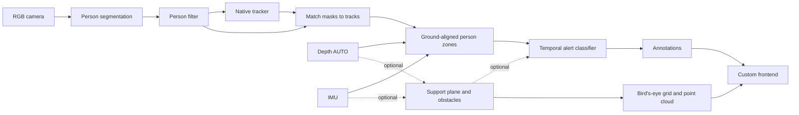

# Machine-Mounted Person Proximity Alert

This example demonstrates proximity alerting from a camera mounted on a machine and looking out from the machine's perspective. It detects people in configurable warning and danger areas in front of the camera and classifies the live view as **Safe**, **Warning**, or **Danger**. The areas are defined relative to the camera, so configure them for its mounting position and the space the machine needs to monitor.

The example uses person instance segmentation, native object tracking, automatically selected depth, and IMU gravity alignment. An optional point-cloud path detects generic obstacles above a support plane found with depthai-nodes `AutoSupportPlane`. The frontend shows the live camera and alert annotations, optional obstacle views, and controls for the detection areas.

> **Note:** This example runs on an RVC4 device in standalone mode and requires RGB, stereo, and IMU sensors. It is an example of visual alerting, not a certified safety system.

## Architecture



DepthAI's `ObjectTracker` assigns person IDs. A host node pairs each track with its instance mask, then evaluates aligned depth pixels in gravity-aligned warning and danger zones. The `Depth` node selects the backend for the connected device; on the tested OAK4-D with DepthAI 3.12, it selected NeuralDepth. The optional obstacle path uses automatic support plane calibration: depthai-nodes `AutoSupportPlane` runs in continuous mode, finds the support plane, and keeps re-verifying it against gravity. Points off the support plane are grouped in a polar occupancy grid, and the zone overlay is laid flat on the support plane. While no support plane passes, obstacle assessment stops and `Support Plane Status` reports the plane as invalid.

## Features

- **Live alerts:** The H.264 `Video` preview and its `Annotations` overlay show tracked-person alerts at the configured FPS.
- **Obstacle views:** With generic detection enabled, `Occupancy Grid` shows the bird's-eye occupancy view, `Support Plane Status` reports whether the support plane is valid, and `Point Cloud` shows the scene-colored point cloud with orange/red zone guides on the support plane. These views open automatically when available.
- **Runtime controls:** Change camera FPS, generic obstacle detection, alert timing, and zone bounds. Applying settings rebuilds the pipeline without restarting the app. DepthAI's default stereo autocalibration runs at every pipeline start, including after applying settings; set `DEPTHAI_AUTOCALIBRATION=CONTINUOUS` to keep it running. The support plane is re-verified about every half second and refit when it no longer matches the scene.

Warning and danger zones use millimetres in the gravity-aligned camera frame: Z extends forward from the camera and negative X is left of centre. The default danger area extends 1 m ahead and 0.5 m to either side; the warning area extends 2 m ahead and 1 m to either side. Adjust these bounds to match the camera mount and machine clearance. The danger distance must be shorter than the warning distance.

Settings reset when the app restarts. Every pipeline start, including after applying settings, searches for the support plane afresh, so the plane shows as invalid briefly until the floor is found.

## Usage

Connect an RVC4 OAK with RGB, stereo, and IMU sensors. Install [`oakctl`](https://docs.luxonis.com/software-v3/oak-apps/oakctl) if needed.

## Peripheral Mode (RVC4)

Requires Python 3.11 and Node.js 22+.

The host also needs Open3D system libraries (`libegl1` and `libgfortran5` on Debian/Ubuntu). The device must have RGB, stereo and IMU sensors.

From this example directory:

```bash
python3.11 -m venv .venv
source .venv/bin/activate
python -m pip install -r backend/requirements.txt
cd frontend
npm ci
npm run build
cd ..
python backend/src/main.py --device <DEVICE_IP>
```

Open http://localhost:8082 on the host computer. Python runs the backend
and serves `frontend/dist` automatically; streams and controls use port 8765.
Rebuild with `npm run build` in `frontend/` after frontend changes.

## Standalone Mode (RVC4 only)

In standalone mode, the app runs entirely on the device, with oakapp serving the frontend automatically. To get started, install [oakctl](https://docs.luxonis.com/software-v3/oak-apps/oakctl), then run:

```bash
oakctl connect <DEVICE_IP>
oakctl app run .
```

Open the HTTPS frontend shown by `oakctl`, normally `https://<DEVICE_IP>:9000/`.

### Remote access

The app can be uploaded to Luxonis Hub with `oakctl` and opened from its App detail page.

### How to Use

1. Mount the camera on the machine so it looks into the area where proximity matters, then open the frontend to view the live camera and alert annotations.
2. Adjust warning and danger distances and horizontal bounds in the right panel for that viewpoint, then apply the settings. The pipeline restarts with the new values.
3. Enable generic object detection to view the bird's-eye grid, support plane status, and point cloud.
