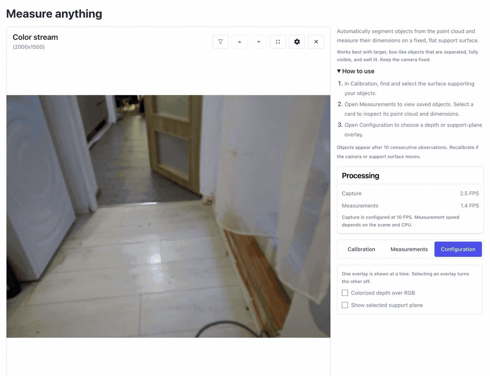
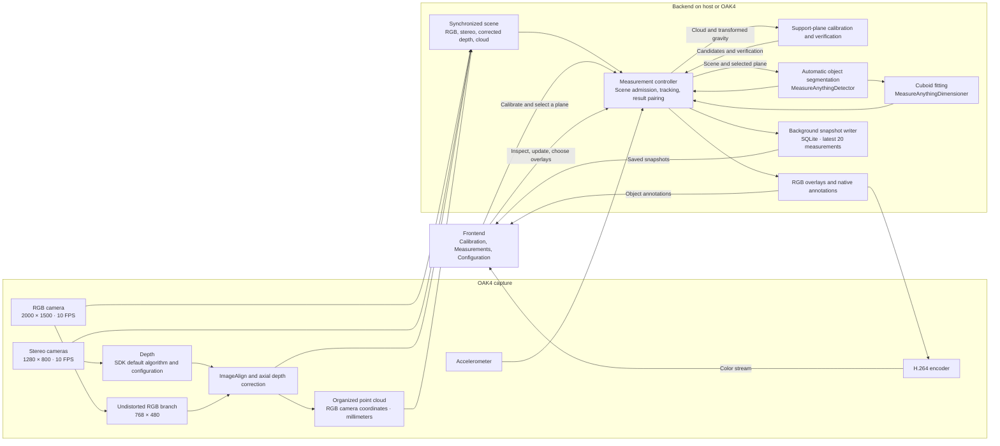

# Measure anything with an OAK4

This app automatically segments objects from a point cloud and measures their length, width, and height without a neural-network object detector. Calibrate the supporting surface, view tracked objects over RGB video, and inspect saved measurements as interactive 3D point clouds.

Works best with larger, box-like objects that are separated, fully visible, and well lit on a fixed, flat support surface. The app requires an OAK4 with RGB, a stereo camera pair, and an accelerometer. Single-camera devices and RVC2 are not supported. The IR dot projector is enabled at full intensity when the device has one.

Physical measurement accuracy has not been validated against reference dimensions. The pinned algorithm has a documented historical failure against a synthetic example's 5 mm dimension tolerance. See [depthai-nodes PR 348](https://github.com/luxonis/depthai-nodes/pull/348) for the implementation and verification limits.

## Demo



## Architecture



Object segmentation and dimensioning use the selected support plane and the scene's point cloud. They do not use a neural-network object detector. Stereo depth uses the unified `Depth` node's SDK defaults, which can include neural depth inference.

The backend pairs measurements with their source RGB frame before encoding. Video follows measurement throughput after calibration and live capture before calibration. The **Processing** section reports capture and measurement rates separately. Capture defaults to 10 FPS; measurement throughput depends on the scene and the backend CPU.

## Usage

Start the app using either mode below. Keep the camera fixed while measuring and leave an uncluttered view of the support surface.

### Calibrate the support plane

1. Open **Calibration** and click **Find support planes**.
2. Inspect the candidate previews. Green pixels mark each candidate surface.
3. Select the supporting table or floor rather than an object's top.
4. Click **Use this support plane**.
5. Keep separated objects fully in view. Confirmed objects receive tracking IDs and dimensions in millimeters over the RGB stream.

An object must appear in 10 consecutive processed frames before its box appears or its measurement is saved. Unknown heights appear as `?`. Failed frames show an explanation without moving the tabs.

Recalibrate after moving the camera or changing the support surface. The app verifies the selected plane every five seconds. If verification fails, measurement pauses and the frontend returns to **Calibration**.

### Inspect and update saved measurements

Open **Measurements** and click an object's card to view its RGB thumbnail, segmented point cloud, fitted cuboid, and saved metadata. The camera-to-cuboid-center distance is the straight-line distance from the RGB camera's optical center. Drag to orbit, right-drag to pan, scroll to zoom, or click **Reset view**.

Click **Update Measurement** to replace the saved snapshot with a fresh observation of the same tracking ID. Temporary tracking loss keeps a pending update through the two-second tracking grace period. After a track expires, recalibration, or an app restart, the object needs a new tracking ID. The app does not recognize physical objects across restarts.

History retains the latest 20 saved measurements and survives app restarts. Standalone runs store the database in `OAKAGENT_STORAGE_APP/measure-anything.sqlite3`. Peripheral runs use this example's `data/measure-anything.sqlite3`. Use `--storage <database-path>` to choose another location.

A failed first save retries automatically while its track remains active. If updating an existing record fails, click **Update Measurement** again. Records saved before thumbnail support show **No preview** until updated.

### Choose RGB overlays

Open **Configuration** to select an overlay. **Colorized depth over RGB** blends depth colors at 50% opacity. Invalid depth stays transparent. **Show selected support plane** highlights the selected surface in green after calibration. Enabling either overlay switches the other off; both default off.

## Peripheral Mode

Use Python 3.12 and Node.js 24. Run the following commands from this directory to install dependencies and build the frontend.

```bash
python3.12 -m venv .venv
.venv/bin/python -m pip install -r backend/requirements.txt
npm --prefix frontend ci
npm --prefix frontend run build
```

Start the backend with an OAK4 connected to your computer or available on the network.

```bash
oakctl run-script .venv/bin/python backend/src/main.py --device <OAK4-IP>
```

Open the complete frontend URL printed in the app logs, including its `ws_url` query parameter. The backend serves the compiled frontend on loopback port 8082 and supplies its connection address in that URL. Use `--frontend-port` to choose another HTTP port.

## Standalone Mode (RVC4 only)

Install [oakctl](https://docs.luxonis.com/software-v3/oak-apps/oakctl), select the OAK4, and run the app from this directory.

```bash
oakctl connect <OAK4-IP>
oakctl app run .
```

The first run builds the container and frontend. Open the `Measure anything frontend at https://<OAK4-IP>:<port>` URL printed in the app logs. The base image serves the frontend and proxies its connection to the backend. The default port is 8000; oakctl can assign another port, such as 9000.

The container uses the Python 3.12 `quay.io/luxonis/oakapp-base:1.5.2` image. The `depthai-nodes` commit pin in [backend/requirements.txt](backend/requirements.txt) is a development dependency. Replace it with a compatible release containing the measurement and depth-correction APIs before merging.

## Validation

Run the backend tests and frontend checks from this directory.

```bash
.venv/bin/python -m unittest discover -s tests -v
npm --prefix frontend run build
npm --prefix frontend run lint
```

For a peripheral run with detailed diagnostics and local scene evidence, use:

```bash
oakctl run-script .venv/bin/python backend/src/main.py --device <OAK4-IP> --log-level DEBUG --evidence evidence
oakctl inspect topics
```

INFO logs report startup and operational changes. DEBUG logs include periodic measurement benchmarks and successful support-plane verification details. A rejected plane remains visible as a warning. The published topics are **Color stream** and **Object annotations**. Depth remains internal.

To replay a matching holistic recording, set `DEPTHAI_REPLAY` to its `.tar` path when starting the backend. The recording must contain RGB, both stereo cameras, IMU data, and the matching calibration. Replayed scenes can validate the workflow but do not establish physical dimension accuracy.

```bash
DEPTHAI_REPLAY=/absolute/path/recording.tar oakctl run-script .venv/bin/python backend/src/main.py --device <OAK4-IP> --storage data/replay.sqlite3
```

When replaying a recording from another camera, the app loads its recorded calibration and camera reference for point-cloud generation. Keep replay checks bounded to the first recording cycle. DepthAI can drift the camera timestamps independently across loops, which can stall synchronized processing. Restart the backend to repeat a bounded check.
