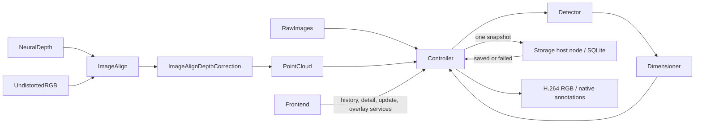

# Measurement history and preview controls

Keep the latest 20 saved parcel measurements available after the app restarts. Each record contains the tracked object's segmented point cloud, fitted cuboid, dimensions, source identity, selected plane, and capture metadata. The Measurements tab opens an interactive detail viewer and can request a fresh snapshot while the object remains visible.

Use the existing parcel example and public depthai-nodes messages. A SQLite store in persistent OAK App storage owns one record per tracking ID. A storage host node serializes and commits snapshots. The controller schedules one object from one sequence, waits for acknowledgement without blocking its event loop, and only saves another batch on a later sequence. Unsaved visible tracks progress sequentially. Explicit updates replace the existing record after a fresh capture. Persist the ID high-water mark to avoid collisions after restarts.

The RGB preview offers calibrated colorized depth and selected support-plane overlays. Project organized XYZ into the delivered RGB calibration, then preserve the original frame identity through encoding. Both overlays default off.

ImageAlign targets a dedicated undistorted RGB grid at 768 × 480. Feed its aligned output and exact source passthrough into the public depth-correction node with an explicit source-axial policy. PointCloud consumes RGB-camera axial Z and emits organized millimeter XYZ in CAM_A coordinates. Filter invalid depth rows before calibration and detection, and retain correction provenance with each saved snapshot. Raw detector images keep their original grids. Verify this path with the installed public-node host fixture and live NeuralDepth metadata on the OAK4.

The UI keeps calibration and processing controls and adds a Measurements tab. Each list row shows tracking ID, labeled dimensions, save time, and whether the object is in frame. The detail modal shows an orbitable point cloud and cuboid, metadata, and an Update Measurement button.

Performance target: mostly stable 10 FPS with up to three visible parcels. Bound measurement admission to two scenes so occasional scheduling jitter does not waste a capture interval. Keep storage at one job. Decode RGB only for operations needing BGR. A preview host node with one waiting frame caches calibrated remapping, combines overlays at depth resolution, and publishes matched video and annotations. Profile separately from timed FPS runs. Measure completed stages and encoded frames across repeated overlay modes and history reads with the operator's three-object scene.

Validation uses unit tests for restart retention, replacement, the scheduler's single-write and sequence rules, failure recovery, and calibrated overlays. Test the packaged application and frontend on the connected OAK4 with an object on a flat surface. Verify a saved cloud and cuboid, explicit replacement, unavailable-object behavior, both overlays, and persistence after restart. Do not compare physical reference dimensions. Holistic replay is pending.

## Work checkpoint

- Blocking first steps: inspect the public parcel fields and device storage, then agree on the snapshot and service contract.
- Independent workstreams: storage and frontend have separate file owners. Controller and rendering integration stay with the lead.
- Shared mutable state: the controller owns scheduling and live presence. One storage node owns writes. Services read small cached summaries or separate SQLite read transactions.
- Smallest safe decomposition: reuse existing host nodes, RemoteConnection, H.264 encoding, and frontend hooks. Add one storage actor and one interactive detail component.
