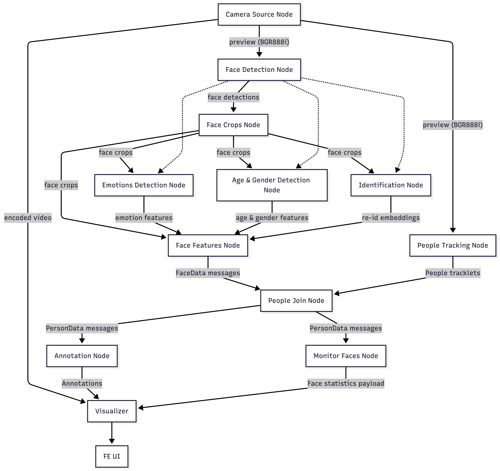

# People Demographics and Sentiment Analysis

This application performs real-time person analytics on Luxonis RVC4 devices.
It detects people and faces, tracks individuals over time, estimates age, gender, emotion and performs re-identification (recognizes if a person has been in the scene before or if it's a new person).

> **Note:** This example works on RVC4 in peripheral or standalone mode.

The app showcases:

- Live annotated Video stream
- Recency-ordered face panel (last seen people)
- Statistics panel (average age, gender ratio, emotion distribution)

## Demo


## Architecture



## Usage

Running this example requires a **Luxonis device** connected to your computer. Refer to the [documentation](https://docs.luxonis.com/software-v3/) to setup your device if you haven't done it already.

## Peripheral Mode (RVC4)

> Requirements pin depthai-nodes commit [`5df28b8`](https://github.com/luxonis/depthai-nodes/commit/5df28b8a65943eaf9fad74691e6cfc544728b189) for `serve_frontend`. Replace this pin with a release containing the helper before merging.

Use Python 3.12 and Node.js 22 or newer. From this example directory:

```bash
python3.12 -m venv .venv
source .venv/bin/activate
python -m pip install -r backend/requirements.txt
cd frontend
npm ci
npm run build
cd ..
python backend/src/main.py --device <DEVICE_IP>
```

Open `http://localhost:8082` on the host computer. Python serves the built custom
frontend and runs the backend; streams and controls use `RemoteConnection` on
port 8765. The frontend directory is resolved relative to the entrypoint.
Rebuild the frontend after changing its source.

Use `--frontend-dir` for another build directory, `--frontend-port` for another
HTTP port, or `--no-frontend` with a separate development server. The default
bind address is `127.0.0.1`; `--frontend-host` overrides it. Access from another
computer requires a separate HTTPS/WebSocket proxy.

Standalone mode keeps the existing oakapp frontend server. The Python helper
automatically skips its listener when that server is configured.

## Standalone Mode (RVC4 only)

Running the example in the standalone mode, app runs entirely on the device.
To run the example in this mode, first install the `oakctl` tool using the installation instructions [here](https://docs.luxonis.com/software-v3/oak-apps/oakctl).

The app can then be run with:

```bash
oakctl connect <DEVICE_IP>
oakctl app run .
```

Once the app is built and running you can access the DepthAI Viewer locally by opening `https://<OAK4_IP>:9000/` in your browser (the exact URL will be shown in the terminal output).

This will run the example with default argument values. If you want to change these values you need to edit the `oakapp.toml` file (refer [here](https://docs.luxonis.com/software-v3/oak-apps/configuration/) for more information about this configuration file).

### Remote access

1. You can upload oakapp to Luxonis Hub via oakctl
2. And then you can just remotly open App UI via App detail
