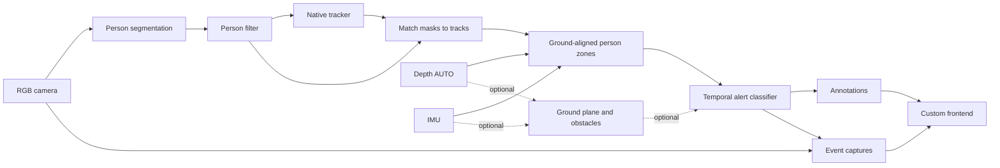

# SafeGuard

SafeGuard is a proximity alert example built with DepthAI. It uses person instance segmentation, native object tracking, automatically selected depth source, and IMU gravity to classify a scene as **Safe**, **Warning**, or **Danger**. An optional point-cloud path also detects generic obstacles above an estimated ground plane.

The custom frontend shows the live camera, recent alert captures, and controls for the detection zones and event recording.

> **Note:** This example runs on an RVC4 device in standalone mode and requires RGB, stereo, and IMU sensors. It is an example of visual alerting, not a certified safety system.

## Architecture



DepthAI's `ObjectTracker` assigns person IDs. A host node pairs each track with its instance mask, then evaluates aligned depth pixels in gravity-aligned warning and danger zones. The `Depth` node selects the backend for the connected device; on the tested OAK4-D with DepthAI 3.12, it selected NeuralDepth. The optional obstacle path fits an IMU-compatible ground plane with RANSAC and groups above-ground points in a polar occupancy grid.

## Features

- **Live alerts:** The `color` preview and `danger` annotation topics show the camera view and tracked-person alerts. When generic object detection is enabled, `grid`, `grid_annotations`, and `pcl` topics are also available.
- **Runtime controls:** Change camera FPS, auto-calibration, generic obstacle detection, ground refit mode, alert timing, and zone bounds. Applying settings rebuilds the pipeline without restarting the app.
- **Recent events:** Select whether warning and danger events are retained. Each retained event can include a JPEG snapshot and a 640 × 360 MP4 clip with configurable pre-trigger and maximum duration. The frontend refreshes the event list every three seconds.

Warning and danger zones use millimetres in the gravity-aligned camera frame. Negative X is left of centre; the danger zone must end closer to the camera than the warning zone.

Events are kept in Python memory, with capture files under `/tmp/safeguard-events-<random>/` in the app container. The app limits the number of events and keeps temporary files within a 1 GB budget, preserving the newest event even if it exceeds that budget. Files are deleted when older events are evicted and the temporary directory is cleaned on normal shutdown. An abrupt termination may leave files until the container is removed. Settings and ground-plane state also reset when the app restarts.

## Usage

Connect an RVC4 OAK with RGB, stereo, and IMU sensors. Install [`oakctl`](https://docs.luxonis.com/software-v3/oak-apps/oakctl) if needed.

## Standalone Mode (RVC4 only)

From this directory, connect to the device and run the app:

```bash
oakctl connect <DEVICE_IP>
oakctl app run .
```

Open the HTTPS frontend shown by `oakctl`, normally `https://<DEVICE_IP>:9000/`.

### Remote access

The app can be uploaded to Luxonis Hub with `oakctl` and opened from its App detail page.

### How to Use

1. Open the `color` stream and enable the `danger` annotation topic to view alerts.
2. Adjust warning and danger distances and horizontal bounds in the right panel, then apply the settings. The pipeline restarts with the new values.
3. Enable generic object detection if you also want ground-plane obstacle alerts and the grid and point-cloud topics.
4. Review recent events below the stream and select one to inspect its saved clip. Captures remain available only while the app is running.
