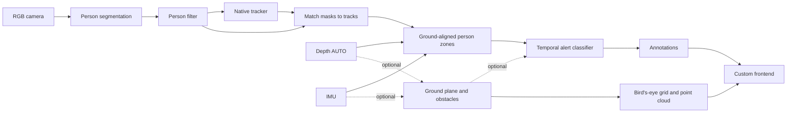

# SafeGuard

SafeGuard is a proximity alert example built with DepthAI. It uses person instance segmentation, native object tracking, automatically selected depth source, and IMU gravity to classify a scene as **Safe**, **Warning**, or **Danger**. An optional point-cloud path also detects generic obstacles above an estimated ground plane.

The custom frontend shows the live camera, proximity alerts, optional obstacle and ground views, and controls for the detection zones.

> **Note:** This example runs on an RVC4 device in standalone mode and requires RGB, stereo, and IMU sensors. It is an example of visual alerting, not a certified safety system.

## Architecture



DepthAI's `ObjectTracker` assigns person IDs. A host node pairs each track with its instance mask, then evaluates aligned depth pixels in gravity-aligned warning and danger zones. The `Depth` node selects the backend for the connected device; on the tested OAK4-D with DepthAI 3.12, it selected NeuralDepth. The optional obstacle path fits an IMU-compatible ground plane with RANSAC and groups above-ground points in a polar occupancy grid.

## Features

- **Live alerts:** The `color` preview and `danger` annotations show tracked-person alerts at the configured FPS.
- **Obstacle views:** With generic detection enabled, `obstacle_annotations` marks detected obstacles on the camera view, `grid` shows the bird's-eye occupancy view, `grid_annotations` reports whether the ground plane is valid, and `pcl` shows green ground points, scene-colored obstacles, and orange/red zone guides. These views open automatically when available.
- **Runtime controls:** Change camera FPS, generic obstacle detection, alert timing, and zone bounds. Applying settings rebuilds the pipeline without restarting the app. Stereo auto-calibration runs continuously, and the ground plane is refit periodically.

Warning and danger zones use millimetres in the gravity-aligned camera frame. Negative X is left of centre; the danger zone must end closer to the camera than the warning zone.

Settings and ground-plane state reset when the app restarts.

## Usage

Connect an RVC4 OAK with RGB, stereo, and IMU sensors. Install [`oakctl`](https://docs.luxonis.com/software-v3/oak-apps/oakctl) if needed.

## Standalone Mode (RVC4 only)

From this directory, connect to the device and run the app:

```bash
oakctl connect <DEVICE_IP>
oakctl app run .
```

Open the HTTPS frontend shown by `oakctl`, normally `https://<DEVICE_IP>:9000/`.

### Remote access

The app can be uploaded to Luxonis Hub with `oakctl` and opened from its App detail page.

### How to Use

1. Open the frontend to view the live camera and alert annotations.
2. Adjust warning and danger distances and horizontal bounds in the right panel, then apply the settings. The pipeline restarts with the new values.
3. Enable generic object detection to view obstacle boxes, the bird's-eye grid, ground-plane status, and the point cloud.
