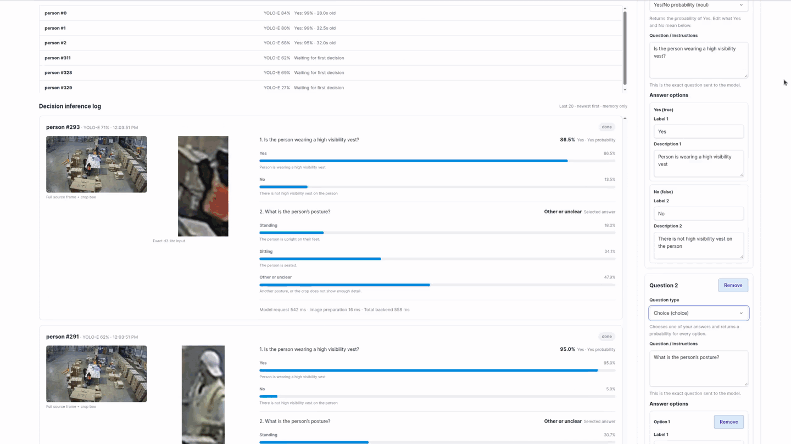
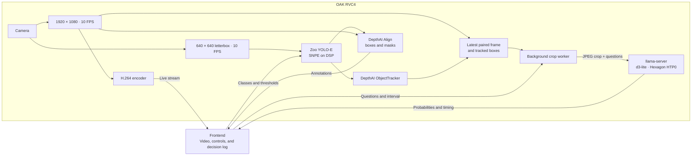

# Visual Decision Model

This standalone RVC4 example is a starting point for applications that use a
**visual decision model**. [d3-lite](https://huggingface.co/vllm-sr/d3-lite)
applies VLM knowledge to user-defined questions about an image and returns
type-safe, structured decisions. You define the question, answer type, and
answer criteria; the backend validates the model's response before showing it.
Questions can cover any visual task expressible as Yes/No, choice, or an ordered
score. This demo uses YOLO-E to supply object crops from a live 1080p stream,
with a default question about whether a person wears a hat.

The app frontend provides controls for:

- Choosing detection classes and adjusting confidence and IoU thresholds
- Starting or pausing decisions and setting the capture interval
- Editing up to four Yes/No, choice, or ordered-score questions
- Reviewing visible objects and the latest 20 decision inferences

> **Note:** RVC4 standalone mode only. Requires Luxonis OS 1.40 or newer.

## Demo



## Architecture



The live video and decision work use separate paths. DepthAI's Align node maps YOLO-E boxes and segmentation masks
from the letterboxed detector input to the 1080p video for the overlay.
ObjectTracker supplies IDs for scheduling decisions; the crop itself comes
from the 1080p frame paired with those tracked boxes. d3-lite does not need
tracklets to evaluate an image, but IDs help distribute requests among visible
objects and attach recent answers to them.

## Features

- **Reusable decision-model pattern**

  - Define the question and answer criteria, submit an image crop, validate the
    typed result, and keep the exact input alongside its probabilities.
  - The included question templates cover a hat check (Yes/No), a person's
    posture (choice), and face visibility (ordered score).
  - YOLO-E is the input source in this demo. The decision question and result
    path can be adapted to another detector or image source.

- **Detection controls**

  - Enter up to 16 comma-separated text classes. The default is `person`.
  - Confidence defaults to **0.35** and IoU to **0.50**. Sliders apply after
    you stop adjusting them; class edits require **Apply classes**.
  - YOLO-E keeps running when decisions are paused.

- **Decision controls**

  - Decisions start paused. The capture interval defaults to **2 seconds**
    and can be set from **0.5 to 30 seconds**.
  - Add one to four questions about each crop. Each question has an instruction
    and answer descriptions; the supported types are **Yes/No probability**,
    **choice**, and **ordered score**. **Apply questions** appears above the
    editors and is enabled when valid question edits need saving.
  - All questions for one crop are sent in a single model request. Pausing
    discards pending captures and prevents an in-flight result from entering
    the log after the pause takes effect.

- **Bounded background processing**

  - At each interval, the app captures the latest frame and its tracked
    detections. One worker evaluates crops sequentially, favoring objects
    that have not been evaluated recently.
  - A newer capture replaces a pending one and ends processing of remaining
    crops from an older capture. When inference takes longer than the interval,
    some captures or objects are skipped; no image backlog grows.
  - The encoded live stream continues independently of decision inference.

- **Decision inference log**

  - Each of the latest 20 entries shows the full 1080p source frame with the
    selected box, the exact JPEG crop sent to d3-lite, YOLO-E class and
    confidence, submitted questions, answer probabilities, and timing.
  - Crops retain their aspect ratio and are downscaled to at most **448 pixels**
    on the longest edge. History stays in memory and clears on app restart.
    The frontend fetches new entries after its initial load.

## Usage

You need an RVC4 OAK device reachable through `oakctl`. Follow the
[OAK and oakctl setup guide](https://docs.luxonis.com/software-v3/oak-apps/oakctl)
if the device is not configured yet.

The app uses `luxonis/oakapp-base:1.5.2-llamacpp` and needs the device's
Hexagon runtime mount and FastRPC devices. The first build or start may need
internet access to obtain the base image, Zoo model, d3-lite weights, and
YOLO-E prompt assets. d3-lite weights and vision projector are downloaded and
SHA-256 verified during the container build; subsequent runs use the assets
in the app image.

### Standalone mode (RVC4)

From this example's directory, run:

```bash
oakctl app run . -d <DEVICE_IP> --detach
```

Open the frontend URL printed by `oakctl` (typically
`https://<DEVICE_IP>:9000/`). Wait for the model status to show **Ready**,
then select classes, configure questions, and press **Start decisions**.

### Remote access

1. You can upload oakapp to Luxonis Hub via oakctl
2. And then you can just remotely open App UI via App detail
