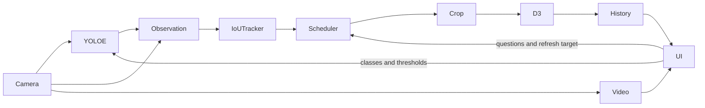

# 2026-11-02 · YOLO-E crop decisions

## First demo

Run on the provided RVC4 device with a live preview, continuous YOLO-E detections, adjustable text classes/confidence/IoU, and a fair one-at-a-time d3-lite scheduler. Allow multiple typed questions per crop. Keep a bounded in-memory inference log with source frame and exact crop. Defer persistence, exports, cross-restart history, and reference images.

## Starting points and topology

- `apps/data-collection`: Zoo YOLO-E, text prompt encoder, runtime parser control and object tracking.
- `apps/llamacpp-anomaly`: d3-lite model assets, local `/v1/systemone` request, decision validation, and Luxonis frontend.
- Standalone RVC4 OAK app on `luxonis/oakapp-base:1.5.2-llamacpp`; no remote inference service.



## UI sketch

```text
Live preview with boxes            Detection controls: classes, confidence, IoU
Object status: class, ID, result    Decision controls: on/off, refresh target, questions
Recent inferences: source+box | exact crop | class | answer probabilities | timing
```

## Evidence and checks

- Frontend builds and lint passes; backend validation and scheduler tests pass.
- OAK4-D R9 (`10.12.143.167`, OS 1.45.0): pipeline, Video and Annotations topics, live preview, and real `box`/`chair` detections verified.
- Confirmed end-to-end d3-lite results and UI source/crop images. One question took about 0.24–0.29 s; two questions in one crop request took about 0.48–0.53 s.
- Confirmed class and threshold changes, decision off/on, and two question types in one request. History is bounded to 20 entries by code and visible in the UI.
- OAK4-S R1 (`10.12.143.173`, OS 1.40.0) rejected even a camera-only pipeline with `Unknown external frame sync role`; the NUC route reproduced it. Forcing `MASTER` reported an unavailable fsync controller. No OS update was attempted.

Holistic recording/replay is pending for this standalone topology.
