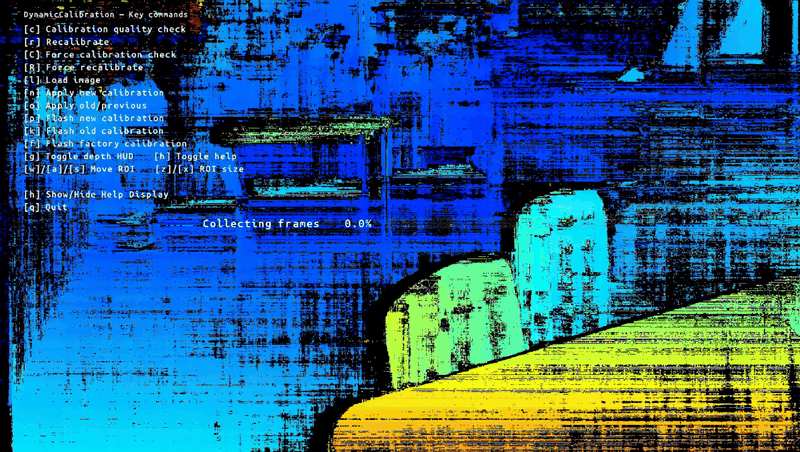

# Stereo Dynamic Calibration

This example demonstrates **runtime stereo camera calibration** with the `DynamicCalibration` node, plus a host-side controller/visualizer that overlays helpful UI (help panel, coverage bar, quality/recalibration modals, and a depth ROI HUD).

It also offers an explicit `AutoCalibration` workflow: choose `--mode on-start` for one startup cycle or `--mode continuous` for periodic validation and recalibration. The default remains `--mode manual` with the full diagnostic controls below.

### Automatic runtime calibration

```bash
python3 main.py --mode on-start --device <DEVICE_IP_OR_ID>
python3 main.py --mode continuous --auto-interval 30 --device <DEVICE_IP_OR_ID>
```

Automatic modes require stereo cameras on `CAM_B` and `CAM_C` with matching native **1280×800 or 640×400** sensor modes and valid stored calibration. The script selects a supported mode before starting the pipeline; unsupported devices fail with an explanation. AutoCalibration uses the unrectified ISP streams; `StereoDepth` continues producing the live preview and depth HUD.

The `DynCalib HUD` shows the selected mode, validation status, data confidence, calibration confidence, and whether the accepted calibration parameters differ from the previous state. Results are also printed as JSON. DepthAI 3.11 cannot serialize `AutoCalibrationResult` directly through RemoteConnection, so inspect the HUD annotations or console results. A successful validation may retain the existing parameters. A failed cycle keeps the active calibration; low-texture or poorly covered scenes may need another viewpoint. Failed results in DepthAI 3.11 report zero confidence fields, so those zeros do not describe each internal retry.

The native acceptance rules remain enabled: five validation images, calibration confidence above `0.9`, the SDK's lens-specific data-confidence threshold, and up to five iterations. `--auto-interval` is the pause **after** each continuous cycle, rather than its total duration. Recalibration and validation run within the SDK; accepted calibration updates refresh device runtime geometry used by the downstream stereo pipeline.

**Automatic modes never flash EEPROM:** `flashCalibration=False` is set explicitly, manual calibration/flash keys are disabled, and no deliberate calibration perturbation is applied. Runtime updates disappear after device restart. The SDK's implicit pipeline automatic-calibration procedure is disabled in all modes so it cannot run alongside these explicit nodes. For persistent calibration, use the manual workflow and its explicit flash controls.

Automatic mode keeps the display controls: `q` quit, `h` help, `g` depth HUD, `w/a/s/d` move ROI, and `z/x` resize ROI. Automatic calibration status is in the help panel, shown by default. Manual calibration commands require restarting with `--mode manual`.

## Features

- **Interactive commands**: start/force recalibration, load images, run quality checks, apply/rollback calibrations, and **flash** (EEPROM) new/previous/factory calibration.
- **Coverage bar**: centered, large progress bar while collecting frames (or briefly after `l`).
- **Quality modal**: big 3-color bar (GOOD / COULD BE IMPROVED / NEEDS RECALIBRATION) with a pointer based on rotation change and a summary of depth-error deltas.
- **Recalibration modal**: summary with Euler angle deltas and depth-error deltas; prompts to flash if there is a significant change.
- **Depth HUD**: optional, shows depth/disp at a movable ROI (center + mean), with a small “tiny box” indicator.
- **Always-on help panel** (toggleable).

## Demo

<p align="center">
  
</p>

## Usage

Running this example requires a **Luxonis device** connected to your computer. Refer to the [documentation](https://docs.luxonis.com/software-v3/) to setup your device if you haven't done it already.

You can run the example fully on device ([`STANDALONE` mode](#standalone-mode-rvc4-only)) or using your computer as host ([`PERIPHERAL` mode](#peripheral-mode)).

Here is a list of all available parameters:

```
--mode {manual,on-start,continuous}
                    Calibration workflow. (default: manual)
--auto-interval AUTO_INTERVAL
                    Positive pause in seconds between continuous cycles. (default: 30)
-d DEVICE, --device DEVICE
                    Optional name, DeviceID or IP of the camera to connect to. (default: None)
-fps FPS_LIMIT, --fps_limit FPS_LIMIT
                    FPS limit. (default: 10)
```

### Controls

Use these keys while the app is running (focus the browser visualizer window):

| Key         | Action                                                                                   |
| ----------- | ---------------------------------------------------------------------------------------- |
| `q`         | Quit the app                                                                             |
| `h`         | Toggle help panel                                                                        |
| `g`         | Toggle Depth HUD (ROI readout)                                                           |
| `r`         | Start recalibration                                                                      |
| `d`         | **Force** recalibration                                                                  |
| `l`         | Load image(s) for calibration (shows coverage bar for ~2s)                               |
| `c`         | Calibration quality check                                                                |
| `v`         | **Force** calibration quality check                                                      |
| `n`         | Apply **NEW** calibration (when available)                                               |
| `o`         | Apply **PREVIOUS** calibration (rollback)                                                |
| `p`         | **Flash NEW/current** calibration to EEPROM                                              |
| `k`         | **Flash PREVIOUS** calibration to EEPROM                                                 |
| `f`         | **Flash FACTORY** calibration to EEPROM                                                  |
| `w / a / s` | Move ROI up/left/down (Depth HUD).<br>**Note:** `d` is reserved for *Force recalibrate*. |
| `z / x`     | ROI size − / +                                                                           |

> **Status banners** appear in the **center** after critical actions (e.g., applying/ flashing calibration) and auto-hide after ~2s.\
> **Modals** (quality/recalibration) also appear centered and auto-hide after ~3.5s or on any key press.

### On‑screen UI Cheat Sheet

- **Help panel** (top-left): quick reference of all keys (toggle with `h`).
- **Coverage bar** (center): big progress bar while collecting frames; also shown briefly (≈2s) after pressing `l`.
- **Quality modal** (center): three colored segments (green/yellow/red) with a **downward** pointer (`▼`) indicating rotation-change severity; optional line with depth-error deltas (@1m/2m/5m/10m).
- **Recalibration modal** (center): “Recalibration complete”, significant-axis warning (if any), Euler angles, and depth-error deltas; suggests flashing if the change is significant.
- **Depth HUD** (inline): shows depth/disp at the ROI center and mean within a tiny box; move with `w/a/s` (and resize with `z/x`).

### Output (console)

- **Coverage**: per-cell coverage and acquisition status when emitted by the device.
- **Calibration results**: prints when a new calibration is produced and shows deltas:
  - Rotation delta `|| r_current - r_new ||` in degrees,
  - Mean Sampson error (new vs. current),
  - Theoretical **Depth Error Difference** at 1/2/5/10 meters.
- **Quality checks**: same metrics as above without actually applying a new calibration.

### Tips & Notes

- To **flash** (EEPROM) from the UI you must pass the `device` into the controller (`dyn_ctrl.set_device(device)`).
- If you link **disparity** instead of **depth** to the controller, call `dyn_ctrl.set_depth_units_is_mm(False)` so the HUD labels use “Disp” instead of meters.
- The coverage percentage accepts either `[0..1]` or `[0..100]` from the device; the controller auto-detects and normalizes.
- The **Collecting frames** bar hides automatically 2s after pressing `l`; during active recalibration (`r`/`d`) it stays up until calibration finishes.

> **NOTE**: If you use this as a base for your own app, the heart of the UX is `utils/dynamic_controler.py` — it wires `DynamicCalibration` queues and renders all overlays via `ImgAnnotations` so you don’t need `cv2.imshow()`.

## Peripheral Mode

## Installation

You need to first prepare a **Python >= 3.10** environment with the following packages installed:

- [DepthAI](https://pypi.org/project/depthai/),
- [DepthAI Nodes](https://pypi.org/project/depthai-nodes/).

You can simply install them by running:

```bash
pip install -r requirements.txt
```

Running in peripheral mode requires a host computer and there will be communication between device and host which could affect the overall speed of the app. Below are some examples of how to run the example.

## Examples

```bash
python3 main.py
```

This will run the example with the default parameters.

```bash
python3 main.py --fps_limit 10
```

This will run the example with the default device and camera input at 10 FPS.

```bash
python3 main.py --device 18443010C1BA9D1200
```

This will run the example on a specific device.

## Standalone Mode (RVC4 only)

Running the example in the standalone mode, app runs entirely on the device.
To run the example in this mode, first install the `oakctl` tool using the installation instructions [here](https://docs.luxonis.com/software-v3/oak-apps/oakctl).

The app can then be run with:

```bash
oakctl connect <DEVICE_IP>
oakctl app run .
```

This will run the example with default argument values. If you want to change these values you need to edit the `oakapp.toml` file (refer [here](https://docs.luxonis.com/software-v3/oak-apps/configuration/) for more information about this configuration file).
