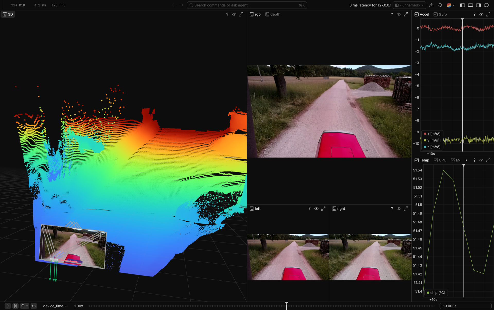

# Rerun Connection

This example demonstrates how to use a **Luxonis device** for streaming to [Rerun Viewer](https://rerun.io/).

## Demo



## Usage

Running this example requires a **Luxonis device** connected to your computer. Refer to the [documentation](https://docs.luxonis.com/software-v3/) to setup your device if you haven't done it already.

You can run the example fully on device ([`STANDALONE` mode](#standalone-mode-rvc4-only)) or using your computer as host ([`PERIPHERAL` mode](#peripheral-mode)).

Here is a list of all available parameters:

```
-d DEVICE, --device DEVICE
                    Optional name, DeviceID or IP of the camera to connect to. (default: None)
-fps FPS_LIMIT, --fps-limit FPS_LIMIT
                      FPS limit. Defaults to 20 on RVC2 and 30 on RVC4. (default: None)
--headless            Don't show GUI (default: False)
--connect             Connect to an external viewer (default: False)
--serve               Host a GRPC & web server and open a web viewer connecting to it. (default: False)
--url URL             Connect to this Rerun URL (default: None)
--save SAVE           Save data to a .rrd file at this path (default: None)
--stdout              Log data to standard output, to be piped into a Rerun Viewer (default: False)
```

By default, the example will open local Rerun Viewer on the device. You can also serve the viewer using a web server by providing the `--serve` argument. To see the stream, open `http://<IP>:9090/?url=rerun%2Bhttp://<IP>:9876/proxy` in your browser, or run `rerun --connect rerun+http://<IP>:9876/proxy` (replace `<IP>` with device IP address). This mode of operation is useful, when running the example on a remote device e.g. in `STANDALONE` mode.

The 3D model of the device is downloaded once from [depthai-ros](https://github.com/luxonis/depthai-ros/tree/develop/depthai_descriptions/urdf/models). Without internet access, or for a model with no mesh, the cameras are shown on their own.

## Peripheral Mode

### Installation

You need to first prepare a **Python >= 3.11** environment with the following packages installed:

- [DepthAI](https://pypi.org/project/depthai/)
- [Rerun](https://pypi.org/project/rerun-sdk/)

You can simply install them by running:

```bash
pip install -r requirements.txt
```

Running in peripheral mode requires a host computer and there will be communication between device and host which could affect the overall speed of the app. Below are some examples of how to run the example.

### Examples

```bash
python3 main.py
```

This will run the example and open a local Rerun Viewer.

```bash
python3 main.py --serve
```

This will run the example and serve the Rerun Viewer on port 9090.

## Standalone Mode (RVC4 only)

Running the example in the standalone mode, app runs entirely on the device.
To run the example in this mode, first install the `oakctl` tool using the installation instructions [here](https://docs.luxonis.com/software-v3/oak-apps/oakctl).

The app can then be run with:

```bash
oakctl connect <DEVICE_IP>
oakctl app run .
```

This will run the example with `--serve`, so view it as described above using the device IP address. If you want to change these values you need to edit the `oakapp.toml` file (refer [here](https://docs.luxonis.com/software-v3/oak-apps/configuration/) for more information about this configuration file).
