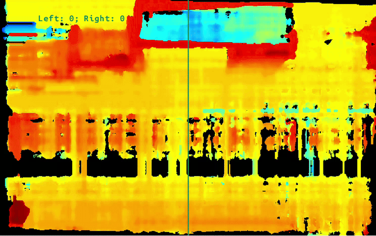

# Depth people counting

This example demonstrates how to count people crossing a virtual line using depth frames captured along a passageway.
By relying solely on depth data (rather than RGB images), this approach preserves privacy while still providing accurate counts — making it well-suited for applications where strict privacy is required.

## Demo

[](media/depth-people-counting.gif)

## Usage

Running this example requires a **Luxonis device** connected to your computer. Refer to the [documentation](https://docs.luxonis.com/software-v3/) to setup your device if you haven't done it already.

You can run the example fully on device ([`STANDALONE` mode](#standalone-mode-rvc4-only)) or using your computer as host ([`PERIPHERAL` mode](#peripheral-mode)).

Here is a list of all available parameters:

```
-d DEVICE, --device DEVICE
                      Optional name, DeviceID or IP of the camera to connect to. (default: None)
-media MEDIA_PATH, --media_path MEDIA_PATH
                      Holistic recording from record.py (recording_<time>.tar.gz, or the extracted directory).
                      (default: live camera input).
-a AXIS, --axis AXIS
                      Axis for cumulative counting (either x or y). (default: x)
-pos AXIS_POSITION, --roi_position ROI_POSITION
                      Position of the axis (if 0.5, axis is placed in the middle of the frame). (default: 0.5)
```

**Note**: This example uses hard-coded values tuned for a specific **RVC2** [recording](./recordings/demo).
They are generally compatible with **RVC4**, but best results are achieved with **RVC2**.
You can test with the provided recordings or run it with your own recordings/camera stream—just be sure to adjust the hard-coded values for optimal performance.
These values depend on factors such as:

- The type of OAK camera
- Installation specifics
- Field of view (FOV)
- Physical structure of the passageway

### Creating Your Own Recordings

`record.py` uses [holistic record](https://docs.luxonis.com/software-v3/depthai/examples/record_replay/holistic_record/). It records `CAM_B` and `CAM_C` and packs calibration into the archive. Replay passes that archive straight through. Do not extract it and rename the videos.

```bash
python3 record.py --output recordings --device <DEVICE_IP> --duration 10
python3 record.py --output recordings --fps 10
python3 main.py --media_path recordings/recording_<time>.tar.gz
```

Press `q` in the visualizer to stop the recording. `--duration <seconds>` stops it without a key press. The script prints the archive path when it finishes. The archive is `recording_<time>.tar.gz`. It contains `CameraCAM_B` and `CameraCAM_C` (H.264 plus metadata) and `camera_info.json`.

`main.py` reads that archive with `pipeline.enableHolisticReplay`. The same `CAM_B` and `CAM_C` camera nodes are used for live and replay. Calibration, camera identity, and frame timestamps come from the recording. `StereoDepth` still runs on the connected device.

`recordings/demo` is the old `left.mp4` / `right.mp4` / `calib.json` folder. That layout is not accepted.

`DEPTHAI_REPLAY` points at the same archive when `--media_path` is omitted. Do not set `DEPTHAI_RECORD` and `DEPTHAI_REPLAY` together, and do not point them at two different recordings. `oakctl app run` does not see these host environment variables. A failed setup warns `Replay disabled` or `Could not set up holistic replay`. `Replay enabled` is an info line and stays hidden at the default log level.

The recording is H.264, so replayed disparity can differ slightly from the live run. On the first replay pass, sequence numbers and device timestamps are the recorded ones. FFV1 AVI is not a replay path: `ReplayVideo` rejects that codec.

## Peripheral Mode

### Installation

You need to first prepare a **Python >= 3.10** environment with the following packages installed:

- [DepthAI](https://pypi.org/project/depthai/),
- [DepthAI Nodes](https://pypi.org/project/depthai-nodes/).

You can simply install them by running:

```bash
pip install -r requirements.txt
```

Running in peripheral mode requires a host computer and there will be communication between device and host which could affect the overall speed of the app. Below are some examples of how to run the example.

### Examples

```bash
python3 main.py --media_path recordings/recording_<time>.tar.gz
```

This replays a holistic recording from `record.py`. The connected device still runs `StereoDepth`.

```bash
python3 main.py -d <DEVICE_IP> -a y -pos 0.75
```

This will run the example on the depth stream from device with the provided device IP, and the cumulative counting axis positioned along the *y* axis at 75% of the frame.

## Standalone Mode (RVC4 only)

Running the example in the standalone mode, app runs entirely on the device.
To run the example in this mode, first install the `oakctl` tool using the installation instructions [here](https://docs.luxonis.com/software-v3/oak-apps/oakctl).

The app can then be run with:

```bash
oakctl connect <DEVICE_IP>
oakctl app run .
```

This will run the example with default argument values. If you want to change these values you need to edit the `oakapp.toml` file (refer [here](https://docs.luxonis.com/software-v3/oak-apps/configuration/) for more information about this configuration file).
