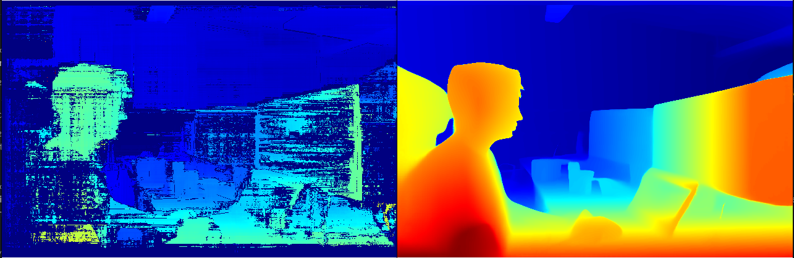
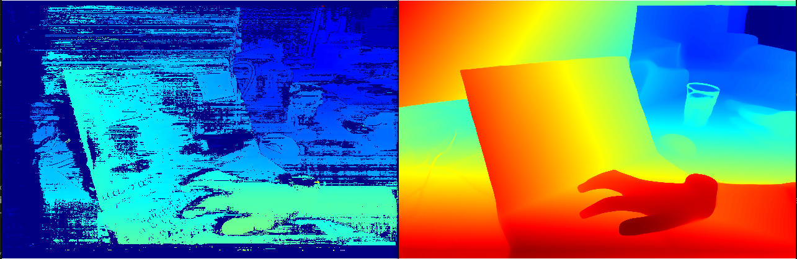

# Stereo ONNX Depth Experiment

This experiment shows how to generate Foundation Stereo with OAK devices, comparing with the disparity
directly from the DepthAI stereo node. The ONNX model is executed on a host computer. The resolution and speed of inference are configurable.

**NOTE**: This demo requires a device with stereo cameras.

**NOTE**: This demo doesn't support Standalone mode because the model is too heavy to run on device.

## Demo

[](media/img1.png)
[](media/img2.png)

## Installation

Prepare your Python environment by installing the required packages:

```bash
pip install -r requirements.txt
```

### Model

This experiment uses ONNX FoundationStereo model which you can check out [here](https://models.luxonis.com/luxonis/foundation-stereo/b8956c24-0b8a-4e49-bd83-ed702252d517). If files are not present locally inside the `./models` they get automatically downloaded from the Zoo. We download a variant that suits the selected resolution:

- 400 resolution -> (640, 416) model input shape
- 800 resolution -> (1280, 800) model input shape

## Requirements

For running the model on **GPU**:

- for resolution 400 the model requires at least 6GB of VRAM
- for resolution 800 the model requires at least 12GB of VRAM

It is possible to run the model on **CPU**, but the generation is significantly slower.

## Usage

The experiment is run in host (Peripheral) mode, using a computer for ONNX inference while the DepthAI device captures and streams image data.

Here are the available parameters:

```
-d DEVICE, --device DEVICE
                    Optional name, DeviceID or IP of the camera to connect to. (default: None)
-fps FPS_LIMIT, --fps_limit FPS_LIMIT
                    FPS limit for the model runtime. (default: 15)
-r {400,800}, --resolution {400,800}
                    Resolution of the streams, select 400 (for 640x400) or 800 (for 1280x800). (default: 400)
```

### Controls During Execution

- Press `F` to generate and display Foundation Stereo Disparity using the ONNX model.
- Press `Q` to exit the application.

## Holistic replay

Replay is optional. The host Foundation Stereo model stays. Record and replay with the same `--resolution`. The archive must contain `CAM_B` and `CAM_C`. The script checks `getConnectedCameras()` before start. With `DEPTHAI_REPLAY` set, that list comes from the recording's `camera_info.json`, so record on a device that already has color, left, and right. A failed setup warns `Replay disabled` or `Could not set up holistic replay`. `Replay enabled` is an info line and stays hidden at the default log level. Press `f` during replay to run the host model on the recorded pair.

```bash
mkdir -p recordings
DEPTHAI_RECORD="$PWD/recordings" python3 main.py
DEPTHAI_REPLAY="$PWD/recordings/recording_<time>.tar.gz" python3 main.py
```

Stop the recording with `q`. Do not set `DEPTHAI_RECORD` and `DEPTHAI_REPLAY` together. `camera_info.json` replaces the device calibration for that run. On RVC2 the recording is replayed on the host. On RVC4 each camera is replayed on the device.

### Peripheral Mode

Below are examples for running the experiment:

#### Examples

Run the experiment with default arguments:

```bash
python3 main.py
```

Run the experiment with a higher resolution (1280x800) and custom FPS:

```bash
python3 main.py --resolution 800 --fps_limit 5
```
