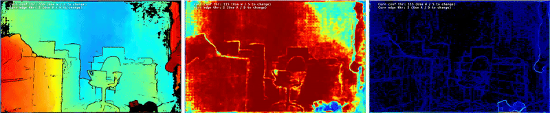

# Neural Depth

This example runs [Luxonis NeuralDepth](https://docs.luxonis.com/software-v3/depthai/depthai-components/nodes/neural_depth/) or [Lite Any Stereo V2 (LAS2)](https://models.luxonis.com/luxonis/lite-any-stereo-v2/aim_Pqtikr7KUqASr1DqzAW5Ho) on an RVC4 device with a calibrated stereo pair on CAM_B/C.

If you are interested in evaluating the model on existing dataset (e.g. Middlebury Stereo dataset) please refer to the [`host_eval`](host_eval/README.md) code.

> **Note:** RVC4 device only.

## Demo



## Usage

Running this example requires a **RVC4 Luxonis device** connected to your computer. Refer to the [documentation](https://docs.luxonis.com/software-v3/) to setup your device if you haven't done it already.

You can run the example fully on device ([`STANDALONE` mode](#standalone-mode-rvc4-only)) or using your computer as host ([`PERIPHERAL` mode](#peripheral-mode)).

Here is a list of the main parameters:

```
--backend {native,las2}
                    Depth backend. Defaults to native NeuralDepth.
-m MODEL, --model MODEL
                    Model variant for the selected backend. Defaults to LARGE (native)
                    or l-fp16-1280x800 (LAS2). Run --help for available variants.
-d DEVICE, --device DEVICE
                    Optional name, DeviceID or IP of the camera to connect to. (default: None)
-fps FPS_LIMIT, --fps_limit FPS_LIMIT
                    FPS limit for the model runtime. (default: 10)
```

Both backends show depth and disparity in the Visualizer. Native NeuralDepth also shows confidence, edge, and runtime controls. LAS2 models download from the Model Zoo on first use.

## Peripheral Mode

### Installation

You need to first prepare a **Python >= 3.10** environment with the following packages installed:

- [DepthAI](https://pypi.org/project/depthai/),
- [DepthAI Nodes](https://pypi.org/project/depthai-nodes/).

You can simply install them by running:

```bash
pip install -r requirements.txt
```

Running in peripheral mode requires a host computer and there will be communication between device and host which could affect the overall speed of the app. Below are some examples of how to run the example.

### Examples

```bash
python3 main.py
```

This runs native NeuralDepth with the `LARGE` model. To run LAS2 instead:

```bash
python3 main.py --backend las2
```

This runs Lite Any Stereo V2 with the default `l-fp16-1280x800` model.

## Standalone Mode (RVC4 only)

Running the example in the standalone mode, app runs entirely on the device.
To run the example in this mode, first install the `oakctl` tool using the installation instructions [here](https://docs.luxonis.com/software-v3/oak-apps/oakctl).

The app can then be run with:

```bash
oakctl connect <DEVICE_IP>
oakctl app run .
```

This will run the example with default argument values. If you want to change these values you need to edit the `oakapp.toml` file (refer [here](https://docs.luxonis.com/software-v3/oak-apps/configuration/) for more information about this configuration file).
