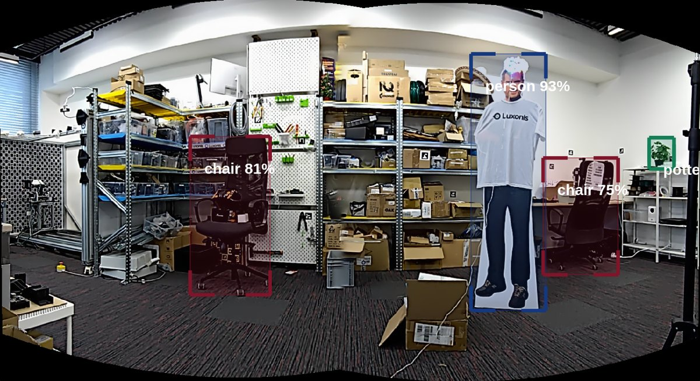
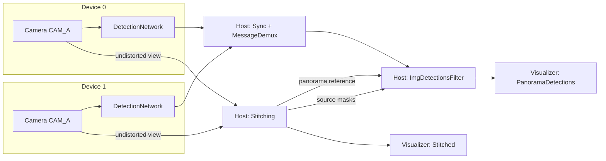

# Calibrated multi-device panorama with YOLO detections

Calibrate two or more OAK devices with the `MultiDeviceCalibration` node, run
YOLOv6-nano on every device, stitch the camera views into one calibrated
panorama with the `Stitching` node and merge the detections from all cameras
into that panorama with the `ImgDetectionsFilter` node. The panorama and the
merged detections are shown in the DepthAI Visualizer.

Everything except the neural networks runs on the host; the devices only
deliver one undistorted camera view and its detections each. RVC2 and RVC4
devices both work. There is no standalone deployment path.

## Demo



## Usage

Running this example requires **two or more Luxonis devices** (RVC2, RVC4 or
mixed) with overlapping fields of view, mounted on a rig that does not move
after calibration. Refer to the
[documentation](https://docs.luxonis.com/software-v3/) to set up your devices
if you haven't done it already.

You can run the example only using your computer as host
([`PERIPHERAL` mode](#peripheral-mode)).

Here is a list of all available parameters:

```
--devices ID [ID ...]      At least two device IDs or IPs
--calibration PATH         Calibration JSON (default: calibration.json beside main.py)
--calibrate                Redo the calibration even if the file exists
--sample-count N           Image groups collected before solving (default: 10)
--known-distance CM        Distance between the first cameras of the first two devices;
                           required for scale only when no device has a stereo pair
-fps N, --fps_limit N      Camera, detection and panorama rate (default: 10)
--projection P             Cylindrical (default), Equirectangular or Perspective
--average                  Average duplicate boxes instead of keeping one
--blend, --no-blend        Seam estimation, exposure compensation and multiband blending
                           (default); --no-blend copies the views directly (faster)
--panorama-scale 1..4      Multiplier of the 640x400 views sent to the host (default: 2)
--sync-threshold-ms MS     Timestamp spread tolerated when grouping (default: one frame period)
--show-inputs              Also show every camera view with its detections
```

`Perspective` needs a combined field of view below 180 degrees; the other
projections also handle wide rigs and full rings. The maximum panorama size is
1600x800 times `--panorama-scale`; a calibration that needs a larger canvas is
rejected rather than resized.

While the example runs, the overlap handling can be changed from the Visualizer:

| Key             | Action                                                        |
| --------------- | ------------------------------------------------------------- |
| `1` / `2` / `3` | Duplicates: off / keep one (NMS, default) / average the boxes |
| `W` / `S`       | Raise / lower the IoU threshold by 0.05 (start 0.40)          |
| `q`             | Quit                                                          |

## Peripheral Mode

Running in peripheral mode requires a host computer and there will be communication between the devices and the host which could affect the overall speed of the app.
You can find more information about the supported devices and the set up instructions in our [Documentation](https://docs.luxonis.com/hardware).
Moreover, you need to prepare a **Python 3.12** environment (recommended) with the following packages installed:

- [DepthAI](https://pypi.org/project/depthai/)

You can simply install them by running:

```bash
pip install -r requirements.txt
```

The first run calibrates the rig: point all cameras at the same textured
scene, keep the rig still and wait for `Calibration saved to ...`. The result
is written to `calibration.json` next to the script and reused by later runs.
Redo it with `--calibrate` whenever a camera has been moved.

Running in peripheral mode opens the DepthAI Visualizer at
[http://localhost:8082](http://localhost:8082). The `Panorama` group shows the
`Stitched` image with `PanoramaDetections` drawn over it.

#### Examples

```bash
python3 main.py --devices DEVICE_1 DEVICE_2
```

This will calibrate the devices on the first run (in any order) and then show
the panorama with merged detections.

```bash
python3 main.py --devices DEVICE_1 DEVICE_2 --show-inputs
```

This will also publish every camera view with its own detections (`Input-N`,
`Detections-N`).

```bash
python3 main.py --devices DEVICE_1 DEVICE_2 --calibrate --known-distance 30
```

This will redo the calibration and set the metric scale from a measured 30 cm
between the first cameras of the two devices (needed only when no device has a
factory-calibrated stereo pair).

```bash
python3 main.py --devices DEVICE_1 DEVICE_2 DEVICE_3 --panorama-scale 1 --no-blend
```

This will stitch three devices with smaller views and without blending, which
suits 100 Mbit links and slower hosts.

## How it works



1. **Calibrate.** When no calibration file exists (or `--calibrate` is given),
   [main.py](main.py) first runs a short pipeline with
   `dai.beta.node.MultiDeviceCalibration`. It uses `CAM_B` and `CAM_C` of each
   device that has a factory-calibrated stereo pair, which fixes the metric
   scale, and the panorama camera otherwise. Only connected cameras with
   factory intrinsics are used; on boards where `CAM_A` is not calibrated
   (some FFC setups) the first calibrated camera replaces it. After `--sample-count` synchronized image groups the
   node solves the pose between the devices and the result is saved as JSON.
2. **Apply the calibration.** The main pipeline loads the JSON and calls
   `pipeline.setMultiDeviceCalibration()`, so every camera transformation is
   expressed in one shared coordinate system.
3. **Detect per camera.** Each device runs `DetectionNetwork` on an undistorted
   `CAM_A` (or replacement) stream. A host `Sync` groups the detections of one capture moment
   and `MessageDemux` routes each camera into its own filter input.
4. **Stitch.** `Stitching` in `PANORAMA` mode with `setUseInputCalibration(True)`
   composes the undistorted views from the calibrated poses. No image features
   are matched, so textureless scenes work and the panorama is available from
   the first synchronized frame group.
5. **Merge detections.** `ImgDetectionsFilter` remaps every camera's boxes into
   the panorama (its `inputReference`), keeps those with confidence >= 0.5 and
   removes duplicates seen by more than one camera. The stitcher's source masks
   tell the filter which camera is visible at a seam, so the kept box is the one
   from the camera whose pixels are shown.

## Troubleshooting

| Symptom                                                               | What to check                                                                                                                                                                                               |
| --------------------------------------------------------------------- | ----------------------------------------------------------------------------------------------------------------------------------------------------------------------------------------------------------- |
| `Calibration failed` or timeout                                       | All cameras need to see the same textured, well-lit scene at the same time. Avoid moving objects and glare. Devices without a stereo pair need `--known-distance`.                                          |
| Panorama appears but the seam is misaligned                           | The rig moved since calibration or the calibration is weak; rerun with `--calibrate`. Nearby objects also shift between cameras (parallax), which no calibration removes.                                   |
| `ImgDetectionsFilter dropping rounds until a valid reference arrives` | Normal once at startup, before the first panorama. If it persists and no panorama appears, check that every camera delivers frames (`--show-inputs`) and that the calibration covers every selected device. |
| `has no factory calibration for its connected cameras`                | The device EEPROM has no intrinsics for any connected camera, so it can be neither calibrated nor undistorted. Use a factory-calibrated device.                                                             |
| Panorama much slower than `-fps`                                      | Network bandwidth: one 1280x800 NV12 view at 10 FPS is about 120 Mbit/s. Use gigabit Ethernet, or `--panorama-scale 1` / lower `-fps` on 100 Mbit links.                                                    |
| Boxes jump or lag behind the image                                    | Lower `-fps`, use wired Ethernet for network cameras and keep all devices on the same link. The devices are free-running; `--sync-threshold-ms` sets how far apart their frames may be.                     |
| Duplicate boxes in the overlap                                        | Raise the overlap by lowering the IoU threshold (`S`) or switch to averaging (`3`). Objects cut by a camera edge yield two partial boxes that may not overlap enough.                                       |

## Limitations

- The cameras must stay fixed relative to each other after calibration.
- Only one camera per device is stitched (`CAM_A`, or the first calibrated camera when `CAM_A` has no factory calibration); the calibration itself may use the
  stereo cameras.
- The example does not estimate depth or build a shared 3D world; see
  [spatial-detection-fusion](../spatial-detection-fusion/) for that.
