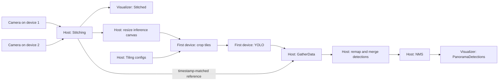

# Native panorama stitching with tiled YOLO detection

Combine overlapping camera streams into a panorama, run tiled YOLO inference,
and display the images and detections in the DepthAI Visualizer.

This example uses **image-content panorama registration** from the
[Luxonis Stitching documentation](https://docs.luxonis.com/software-v3/depthai/depthai-components/host_nodes/stitching).
It requires overlapping, textured views rather than inter-camera calibration.
Stitching runs on the host for both **RVC2 and RVC4**; YOLO runs on the first
selected device. This example has no standalone deployment path.

## Run

Requires Python >=3.10 and the pinned dependencies in `requirements.txt`.
The requirements select DepthAI snapshot
`3.12.0.dev0+d4cb5b0f547f42ad39312c0dec48802b41028fa7` from the Luxonis snapshot index.
Native host stitching needs DepthAI with OpenCV support, enabled by default.

```bash
# From the repository root:
cd tutorials/multiple-devices/multiple-device-stitch-nn

python3 -m venv .venv
. .venv/bin/activate
python -m pip install -r requirements.txt

# Two physical devices with overlapping views, in left-to-right order:
oakctl run-script python main.py --devices LEFT_DEVICE_ID RIGHT_DEVICE_ID --sockets CAM_A
```

Pass both device IDs or IPs after `--devices`. With `--sockets CAM_A`, this
selects one camera on each device, for two sources total. `--sockets` defaults to
CAM_A and applies to every selected device: `--sockets CAM_B CAM_C` on two
devices would select four sources. To diagnose stitching with two sensors on
just one device, use `--devices DEVICE_ID --sockets CAM_B CAM_C` instead.
Use `-fps` to change the capture rate (default 10) and `-is` to change the
input resolution (default 360p). Run `python main.py --help` for choices.

Open **http://localhost:8082** in the Visualizer. By default, it shows only the
`Stitched` panorama with `PanoramaDetections` overlays.

To inspect the individual camera views as well, add `--show-inputs`:

```bash
oakctl run-script python main.py --devices LEFT_DEVICE_ID RIGHT_DEVICE_ID --sockets CAM_A --show-inputs
```

This also publishes `Input-0`, `Input-1`, and any additional source streams.

The resized inference canvas stays internal. Only the panorama detection stream
is published, so each object has one label and box.

Press **r** to reset registration after moving cameras, **q** or Ctrl-C to stop.

## Follow the pipeline

Start with [main.py](main.py). `main()` opens the devices and builds the
panorama; `add_inference()` connects the tiled detector to that panorama.



1. **Select the sources.** Each requested socket creates a camera on each
   selected device. With two device IDs and `CAM_A`, there are two sources.
   With `--show-inputs`, `Input-0` and `Input-1` show them before stitching.
2. **Register and compose.** Stitching groups frames by timestamp, finds shared
   image features, and estimates how the views fit together. Once registration
   succeeds, it reuses the transform to compose subsequent panoramas.
3. **Run tiled inference.** Host ImageManip resizes the panorama into an inference
   canvas whose width grows with the source count. `Tiling` defines one tile per
   source in a horizontal row with 50% overlap. `FrameCropper` crops and resizes
   those tiles, and YOLO runs on each tile on the first selected device.
4. **Restore panorama coordinates.** A detection initially belongs to its tile.
   `GatherData` waits for the tile results belonging to a panorama timestamp.
   [MergeImgDetections](utils/merge_img_detections.py) uses each message's
   transformation to map its boxes into that full panorama before merging them.
5. **Remove duplicate boxes.** Overlapping tiles can detect the same object.
   Per-class non-maximum suppression (NMS) keeps the strongest overlapping boxes
   before the results are displayed over `Stitched`.

This demonstrates image stitching and detection-coordinate mapping. It does not
estimate object depth or produce a shared 3D world map.

## How stitching works

Native `dai.node.Stitching` synchronizes the inputs internally. This example
uses PANORAMA mode, evaluates three valid registration candidates, and reuses
the strongest transform for subsequent frames. Failed candidates do not count;
no panorama is emitted until registration succeeds.
`setUseInputCalibration(False)` explicitly selects image-content registration;
the snapshot defaults to calibrated composition.

The settings in `main.py` use a perspective projection, DP_COLOR seams, a
4096x2048 maximum panorama size, and a 100ms synchronization threshold.
Perspective projection suits a narrow combined field of view below 180° and
supports this example's native detection remapping. The size limit rejects
oversized registrations before composition; it does not resize them to fit.
Synchronization groups frames by timestamp and does not align camera exposures.

Use rigidly mounted cameras with substantial overlap and textured scenes.
Wide baselines and nearby objects can cause parallax. If registration fails,
rerun with `--show-inputs` and check the input streams and camera placement;
there is no concatenation fallback.
See the [Stitching documentation](https://docs.luxonis.com/software-v3/depthai/depthai-components/host_nodes/stitching)
for calibrated panorama composition, cylindrical/360° views, planar projection,
seam choices, and synchronization options beyond this example.

## Inference

The native panorama is BGR888i and carries its virtual-camera transformation.
ImageManip resizes it for tiled inference and selects BGR888p for RVC2 or
BGR888i for RVC4. Timestamp-matched references and native
`ImgDetections.transformTo()` map tile detections directly to the full panorama
before NMS and display. Camera sources may span multiple
devices; the first device selects the inference model platform.

Inference uses native `dai.node.DetectionNetwork`. Tiling, cropping, timestamp
gathering and host NMS use `depthai-nodes`. Its `ImgDetectionsFilter.useNms()`
suppresses duplicates within the merged tile detections; the snapshot's native
filter only suppresses duplicates between separate inputs. The small merge helper
preserves the matched reference transformation when moving detections from tiles
to the panorama.

## Network and performance

For network-connected cameras, start with **wired Ethernet on the host as well
as the cameras**. A camera connected to a PoE switch can still communicate over
Wi-Fi if that is the host's selected route. On Linux, replace `DEVICE_IP` below
with each camera's address and check the interface reported after `dev`:

```bash
ip route get DEVICE_IP
```

Adding an Ethernet cable does not guarantee existing connections switch to it.
After correcting the route, quit and rerun the example to open new connections.

The default is 10 FPS at 360p per input. Raw camera frames travel to the host
for stitching, and the resized inference canvas travels back to the first
device. A constrained connection or slow processing stage can fill queues and
make the displayed images seconds old. A visibly updating stream can therefore
still be delayed. Reduce the input rate to check whether the pipeline can keep up:

```bash
oakctl run-script python main.py --devices LEFT_DEVICE_ID RIGHT_DEVICE_ID --sockets CAM_A -fps 5
```

Higher input resolutions increase registration, composition, and transfer costs.
Adding sources also adds tiles, so each panorama requires more NN inferences.
10 FPS was observed with two RVC4 devices and one 360p `CAM_A` stream each over
Ethernet; it is an example measurement, not a guaranteed rate for other rigs.

## Troubleshooting

For registration problems, rerun with `--show-inputs` to inspect the source views.
Without that flag, only the panorama and its detection overlay are published, so
there is no image to display until registration succeeds.

| What you see                                                | What to check                                                                                                                                                                                                                                        |
| ----------------------------------------------------------- | ---------------------------------------------------------------------------------------------------------------------------------------------------------------------------------------------------------------------------------------------------- |
| Input streams appear, but no panorama                       | Let exposure settle, then check that neighboring views share substantial, textured, well-lit background. Keep the cameras still. Three valid registration candidates are needed; failed candidates do not count.                                     |
| `need more images` or `camera parameters adjustment failed` | Inspect both input views for insufficient overlap, blank surfaces, blur, or moving foreground objects. Adjust the rig, let the scene settle, and press **r** with the Visualizer focused. An initial warning alone does not mean startup has failed. |
| Panorama appears after a long wait                          | Registration may be retrying unsuccessful candidates. Once a transform is fixed, subsequent frames reuse it; repeated initial registration work is separate from steady-state FPS.                                                                   |
| Panorama or boxes lag behind the source views               | Check the host's route to every camera, use Ethernet, and reduce FPS. Restart after changing the route to discard the old connection and queued frames.                                                                                              |
| Nearby objects are doubled or joins do not line up          | Wide camera spacing and objects near the cameras cause parallax. Move cameras closer together and test against a more distant scene. Resetting registration cannot remove all parallax.                                                              |
| Panorama is present, but there are no boxes                 | Check for objects recognized by the YOLO model. An empty detection list can be valid; distinguish it from a missing detection stream with `oakctl inspect dump PanoramaDetections --count 2 --timeout 10s`.                                          |
| Attribute errors or deprecated beta-node warnings           | Install this directory's pinned requirements into the same environment used to run the example. The filter and Stitching APIs differ across DepthAI versions.                                                                                        |

Registration has no timeout or concatenation fallback: unsuccessful registration
emits no panorama or detections. Input topics remain available with
`--show-inputs`. Pressing
**r** discards the cached composition and starts registration again; it does not
calibrate the cameras.
