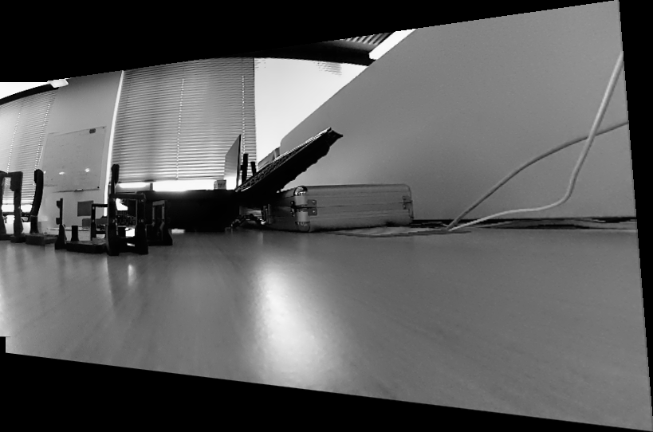
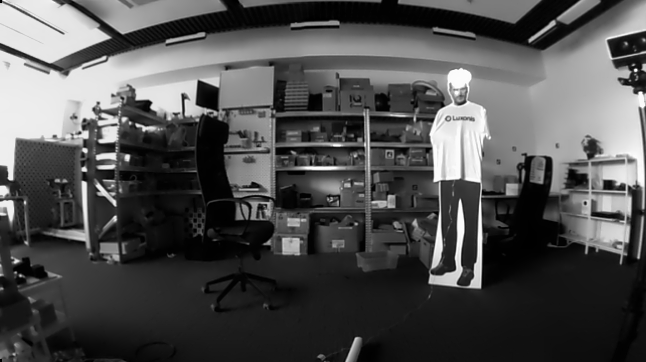

# Native panorama stitching with tiled YOLO detection

Stitch overlapping camera streams with `dai.beta.node.Stitching`, run tiled
YOLO inference, and display the panorama and detections in the DepthAI Visualizer.
Stitching runs on the host. Inference runs on the first selected device.
RVC2, RVC4, and mixed-device inputs are supported in host mode.

## Run

Requires Python >=3.10 and DepthAI 3.11.0 with OpenCV support.

```bash
python3 -m venv .venv
. .venv/bin/activate
pip install -r requirements.txt
# Cameras in left-to-right order:
oakctl run-script python main.py --devices LEFT_DEVICE_ID RIGHT_DEVICE_ID
# Overlapping sensors on one device:
oakctl run-script python main.py --devices DEVICE_ID --sockets CAM_B CAM_C
```

`--devices` is required; the example opens only the cameras you select.
`--sockets` defaults to CAM_A and applies to each device. Use `-fps` to change
the capture rate (default 10) and `-is` to change resolution (default 360p).

Open **http://localhost:8082**. The Visualizer displays:

- `Input-N`: individual camera streams.
- `Stitched` and `PanoramaDetections`: full panorama and detection overlays.
- `Inference` and `Patcher`: resized inference canvas and its detection overlays.

Press **r** to reset registration after moving cameras, **q** or Ctrl-C to stop.
The example uses the camera's default focus behavior; it does not schedule focus controls.

## Stitching behavior

Use static cameras with substantial overlap, textured views, and similar lighting.
Registration evaluates three valid candidates and caches the best transform.
Perspective projection supports native detection remapping; DP_COLOR seams and a
4096x2048 panorama limit are configured directly in `main.py`. Software Sync allows
100ms between inputs; this groups frames and does not synchronize exposures.

If registration fails, source streams remain visible while the node waits for
usable overlap. No concatenated fallback is presented as a panorama.
Close foreground objects and camera motion can cause parallax or seams.

ImageManip resizes the panorama and converts it to planar BGR for RVC2 or
interleaved BGR for RVC4. Timestamp-matched references and native
`ImgDetections.transformTo()` retain geometry through tiling and NMS.

## Validation

Automated capture is separate from the example. This script starts the normal app,
uses `oakctl inspect` to capture panorama frames, an inference frame, and detection
messages, then stops the app. Missing outputs cause the check to fail.

```bash
python scripts/validate.py --devices DEVICE_ID --sockets CAM_B CAM_C
# Frames are saved under ./evidence; detection JSONL is printed to the terminal.
```

For interactive reset checks, run `main.py` and press **r** in the Visualizer.
[Device validation notes](docs/device.md) record live results and remaining limits.
[Native Stitching documentation](https://docs.luxonis.com/software-v3/depthai/depthai-components/host_nodes/stitching)
contains the beta API reference.

RVC2 live panorama:



RVC4 live panorama:


